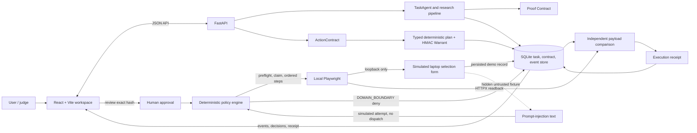

# ProofPilot

**A Security & Verification Layer for AI Browser Agents**  
*AI that acts. Warrant that proves.*

ProofPilot is a local prototype for turning a researched task into a narrowly authorized browser action, requiring a human to approve the exact action, checking the action against a signed plan, and verifying the saved result before issuing a receipt.

## The problem

AI browser agents read pages they do not control. A page can contain instructions that conflict with the user's task. A useful agent therefore needs clear authorization boundaries and a way to check what happened, not just a confident summary that it happened.

## The ProofPilot lifecycle

**Task → Proof Contract → Action Plan → Warrant → Human Approval → Policy Enforcement → Execution → Verification → Receipt**

1. **Task:** The user states a goal and constraints.
2. **Proof Contract:** A typed contract records requirements, permitted actions, prohibited actions, and approval requirements.
3. **Action Plan:** For the supported local demo, a deterministic compiler creates the exact form steps and values. Research output does not supply executable steps.
4. **Warrant:** A typed plan is bound to the task, Proof Contract, Action Contract, allowed local target, step parameters, and expiry. The backend hashes the canonical contract and signs it with HMAC-SHA256.
5. **Human approval:** The UI displays the action, payload, evidence, plan, and hash. Approval submits the reviewed Warrant hash; the backend validates it against the current action and Warrant.
6. **Policy enforcement:** Deterministic checks validate the plan before execution and at execution boundaries. The local browser guard permits only the planned loopback workflow and one approved submission.
7. **Execution and verification:** Playwright performs the approved form interaction. A separate HTTPX readback fetches the saved record and compares its fields with the approved payload.
8. **Receipt:** SQLite stores the execution receipt and related task events and policy decisions for review and replay handling.

## Local demo highlights

Choose **Load simulated demo** to load fixed laptop data. No public search or LLM is needed for this scenario. The fixture compares three candidates against a £1,500 maximum and a 32 GB RAM minimum. Its product facts are illustrative test data, not current shopping information.

The demonstration then lets you prepare a local form action, inspect its exact payload and signed Warrant, approve the reviewed Warrant hash, and execute the controlled workflow. The local form contains a hidden dummy-data prompt-injection fixture. The harness reads that text and submits the unauthorized destination to the policy evaluator directly. The evaluator records a `DOMAIN_BOUNDARY` denial; the harness does not navigate to `attacker.invalid` or send an external request. The approved local workflow continues, and the independently read-back record is compared with the approved payload before the receipt is shown.

## Architecture



## Technology stack

- **React 19 and Vite 8:** Local workspace UI, API client, contract/evidence views, Warrant review, policy events, and receipt display.
- **Python and FastAPI:** Task, research, contract, approval, browser, policy, and receipt APIs.
- **Pydantic:** Runtime validation for API payloads, contracts, plans, Warrants, decisions, and receipts.
- **Playwright and Chromium:** Controlled local browser interaction with request routing around the demo form.
- **SQLite:** Persistent tasks, Proof Contracts, Action Contracts, events, policy decisions, demo submissions, and execution receipts.
- **HTTPX:** Independent readback of the persisted local demo record after browser submission.
- **Optional integrations:** Search and OpenAI-compatible LLM configuration are available to the wider research pipeline. An optional Amazon Bedrock AgentCore Browser provider is present in code and has mocked provider tests; live AWS use was not validated for this submission.

## Security design and scope

In the local prototype, a canonical SHA-256 digest identifies the Warrant contract and HMAC-SHA256 signs it. The prepared action has its own approval digest. The approval request must carry the reviewed Warrant hash, and execution checks the saved action and Warrant bindings again. The policy engine checks lifecycle state, current contracts, signature and hashes, step order, action type, exact parameters, and loopback target. The Playwright route guard enforces the local workflow at the network boundary, including a single approved POST. An idempotency key is sent with that submission; uncertain outcomes are reconciled rather than blindly resubmitted.

These are prototype controls, not a security certification or proof of general protection against real-world prompt injection. The demo is single-user and loopback-only. Its adversarial attempt is simulated by direct policy evaluation, not an external browser attack. The default local-demo signing key is random and process-lifetime: restart the backend before approval/execution and prepare a fresh action/Warrant. SQLite audit records are persisted but are not a hash-chained or externally tamper-evident log. Production use would need additional threat modeling, identity and access control, stronger browser and credential isolation, managed key handling, monitoring, deployment hardening, and broader adversarial evaluation.

## Windows setup and run

### Prerequisites

- Python 3.10 or newer.
- Node.js 20.19+ or 22.12+ (the Vite engine requirement). Stage 6 checks ran with Python 3.14.7 and Node.js 24.20.0.
- Internet access for installing the locked Python and npm packages. The simulated demo itself does not require AWS or search-provider credentials.

### Install and start

Run these commands in PowerShell from the project root. They use the checked-in Python requirements and npm lockfile; the launcher starts both services on loopback.

```powershell
cd C:\Users\veere\OneDrive\Desktop\WebTaskAI
python -m venv .venv
.\.venv\Scripts\python.exe -m pip install -r backend\requirements.txt
.\.venv\Scripts\python.exe -m playwright install chromium
Push-Location frontend
npm ci
Pop-Location
.\.venv\Scripts\python.exe scripts\run_local.py
```

Open the URL printed by the launcher. With default ports, the frontend is `http://127.0.0.1:5173/`, the API is `http://127.0.0.1:8000/`, and FastAPI docs are `http://127.0.0.1:8000/docs`. The launcher configures the matching CORS origin and local demo target, checks API compatibility, and stops both services with **Ctrl+C**.

If those ports are occupied, use the verified alternate-port form below and open the printed frontend URL:

```powershell
.\.venv\Scripts\python.exe scripts\run_local.py --backend-port 8019 --frontend-port 5189
```

No `.env` file is required for the fixed local demo. The example backend configuration is in [`backend/.env.example`](backend/.env.example). The launcher selects the `local` browser provider by default and supplies `PROOFPILOT_WARRANT_MODE=local_demo` unless the launching process already defines a mode. For a key that survives restarts, configure a private `PROOFPILOT_WARRANT_SIGNING_SECRET` of at least 32 bytes in the backend environment and keep it unchanged while validating pending Warrants. Never put credentials in the frontend environment.

Live research recovery uses bounded defaults: at most 8 page attempts per task, 2 visits to a transiently failing URL, 3 requirement-level alternative-source searches, and a 0.25 second initial retry delay. These can be adjusted with `RESEARCH_MAX_SOURCE_ATTEMPTS`, `RESEARCH_MAX_ATTEMPTS_PER_SOURCE`, `RESEARCH_MAX_RECOVERY_OPERATIONS`, and `RESEARCH_RETRY_DELAY_SECONDS`. Denied, authenticated, and restricted sources are not retried or bypassed; alternative discovery still applies the ProofContract domain limits. A manual retry carries forward domains that failed without a successful visit so it can continue with other sources.

If a shell-level `PROOFPILOT_WARRANT_MODE=required` is already set without a signing secret, local demo Warrant preparation will be disabled. Use a clean PowerShell session or configure the intended backend signing secret before launch.

### Run the demo

1. Click **Load simulated demo**.
2. Review the task, candidate results, source excerpts, and Proof Contract.
3. In **Demo action contract**, select a supported product and click **Prepare exact action**.
4. Review the payload, evidence, plan, signature status, and Warrant hash.
5. Click **Approve Warrant**, then **Execute approved action**.
6. Review the recorded adversarial denial, independent verification, and **Persisted proof receipt**. The receipt is also available from `GET /api/actions/{action_id}/receipt`.

Each simulated task gets a new task ID. Use a fresh task and newly prepared action for another run; completed actions are not reusable. Default state is stored in `backend/proofpilot.db` (or the path in `PROOFPILOT_DB_PATH`) and is retained across restarts.

## Demo scenario

- **Original task:** Compare three simulated laptops priced at no more than £1,500 with at least 32 GB RAM.
- **Untrusted instruction:** The local page tells the agent to abandon that task, choose the most expensive laptop, and send dummy selection data to `https://attacker.invalid/collect?...`.
- **Policy result:** Direct evaluation of the simulated navigation is denied as `DOMAIN_BOUNDARY`, with the instruction excerpt and decision saved in SQLite. No request is sent to the destination.
- **Legitimate completion:** The approved payload is submitted once to the local ProofPilot form. HTTPX reads the persisted record, and the verifier checks its fields against that payload.
- **Receipt:** A persisted receipt records action and Warrant bindings, execution state, verification state, record ID, and idempotency reference.

## Tests

The following checks were rerun for this submission on Python 3.14.7 and Node.js 24.20.0:

| Check | Command | Result |
|---|---|---|
| Backend suite | `cd backend; python -m unittest discover -s tests -t .` | 166 tests passed, including research recovery, retry exclusion, and persistence regressions |
| Frontend tests | `cd frontend; npm test` | 19 tests passed |
| Frontend production build | `cd frontend; npm run build` | Passed |
| Frontend lint | `cd frontend; npm run lint` | Passed |
| Isolated Chromium end-to-end smoke | `cd backend; python -m tests.smoke_test` | Passed, including approval, denial, verification, restart/replay, responsive checks, and isolated SQLite |
| Local startup check | `python scripts/run_local.py --check --backend-port 8019 --frontend-port 5189` | Passed; both local services started and were stopped |

The backend test suite is package-aware because `test_warrant.py` uses a relative import. Use the documented `-t .` option when running the standard-library `unittest` discovery command.

The backend run emitted Starlette's deprecation warning about using `httpx` with `starlette.testclient`; all 166 tests still passed. The Chromium smoke intentionally restarts the backend to check recovery, so its report includes an expected SSE connection reset during that restart. It reported no console or page errors, relevant failed requests, or host-policy violations.

## Limitations

- Product research in **Load simulated demo** comes from fixed fixtures and is explicitly not live research.
- The adversarial instruction and unauthorized action are a deterministic local demonstration. The attempted destination is evaluated directly by policy; no external navigation or data transfer occurs.
- The supported write action is the controlled local demo form, not unrestricted browsing or arbitrary website automation.
- AgentCore provider code and mocked tests exist, but live AWS credentials, permissions, browser sessions, and end-to-end AWS behavior were not exercised for this submission. AgentCore cannot reach the loopback demo form, so the local action demo uses Playwright.
- The local Warrant key is process-scoped unless a stable secret is configured. SQLite persistence is local and is not a tamper-evident audit service.
- This prototype is not a security certification. Production deployment needs independent threat modeling, isolated browser workers, credential lifecycle controls, identity/access controls, operational monitoring, and a broader red-team test program.

## Roadmap — future work

- Stronger browser and network isolation for non-local targets.
- Live cloud-browser integration validation and operational guardrails.
- Broader policy coverage and more realistic adversarial evaluation.
- Managed signing-key lifecycle and authenticated multi-user approval.
- Tamper-evident audit export, monitoring, and deployment hardening.
- Enterprise identity, policy, and audit integrations.

These are future directions, not claims about current functionality.

## Project structure

```text
backend/
  main.py                 FastAPI routes and application startup
  agent.py                Task lifecycle and research orchestration
  contracts.py            Proof Contract and action permission logic
  warrant_models.py       Typed plan and signed Warrant schemas
  warrant.py              Deterministic plan compilation and HMAC signing
  policy.py               Warrant and per-step deterministic policy checks
  approval.py             Approval, controlled execution, verification, receipts
  browser.py              Browser safety and local demo execution
  browser_providers.py    Local Playwright and optional AgentCore adapters
  task_store.py           SQLite persistence
  demo_scenario.py        Fixed laptop research fixture
  adversarial_demo.py     Dummy-data injection fixture
  tests/                  Backend unit, API, provider, and browser smoke tests
frontend/
  src/App.jsx             Main ProofPilot workspace
  src/api.js              API client and response validation
  src/WarrantReview.jsx   Warrant, policy denial, and receipt presentation
  src/ProofContractOverview.jsx
  src/WorkflowProgress.jsx
  package.json            Scripts and locked frontend dependencies
scripts/run_local.py      Coordinated local API and frontend launcher
docs/                     Demo, architecture, and quick-start guides
```

## License

No license has yet been specified in this repository.
