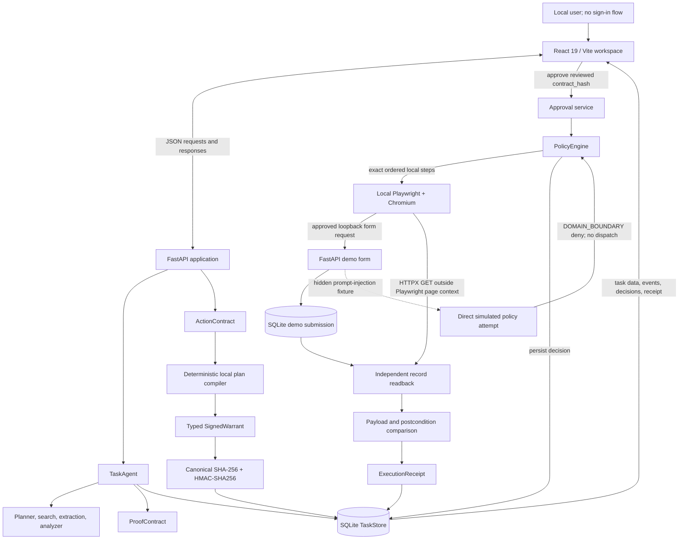
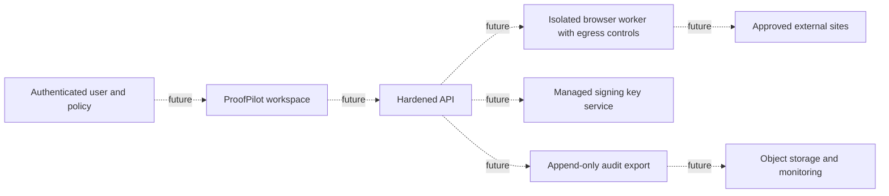

# ProofPilot architecture

This document describes the repository's current local prototype. The diagrams do not imply a deployed cloud service or live AWS validation.

## Current system components



### Components

- `frontend/src/App.jsx` is the workspace. `frontend/src/api.js` sends JSON requests, applies deadlines, validates response shapes, and surfaces API errors. Warrant, Proof Contract, workflow, evidence, and receipt views are separate React components.
- `backend/main.py` constructs the FastAPI app, registers CORS and exception handlers, and exposes task, event, demo, contract, Warrant, approval, action, and receipt endpoints.
- `backend/agent.py` manages task lifecycle and research orchestration. The `/api/demo/scenario` endpoint instead creates a completed task from fixed data in `backend/demo_scenario.py`; that route does not run public search.
- `backend/contracts.py`, `backend/models.py`, and `backend/warrant_models.py` define typed task, evidence, Proof Contract, Action Contract, plan, Warrant, and receipt shapes.
- `backend/warrant.py` compiles the supported local form plan from the Action Contract. It does not use an LLM to author executable steps.
- `backend/policy.py` validates the current task and contract, Warrant integrity, approval bindings, exact target, action type, ordered step, and parameters; it records allow/deny decisions through the supplied persistence callback.
- `backend/approval.py` coordinates action preparation, human approval, preflight, atomic execution claim, browser execution, readback, verification, and receipt/reconciliation state.
- `backend/browser.py` implements the controlled form workflow and network guard. `backend/browser_providers.py` supplies local Playwright and optional AgentCore provider adapters.
- `backend/task_store.py` stores tasks, drafts, contracts, actions, execution events, policy decisions, receipts, submissions, and execution state in SQLite.

## Data flow and local research

For a normal task, the UI posts a task to `/api/tasks`. The TaskAgent stores task state, runs its existing research pipeline, and persists events and results. The resulting Proof Contract defines requirements, allowed and prohibited actions, and where approval is required. Evidence records link claims to source excerpts.

The hackathon demo uses `/api/demo/scenario` instead. It creates three predetermined laptop source records and their extracted claims, evaluates the requirements, and persists a completed task, Proof Contract, and task events. It makes no public search or LLM call. The page's hidden adversarial fixture is used later by the controlled action demonstration; the recorded instruction is not processed by an LLM.

## Authorization and Warrant lifecycle

```mermaid
sequenceDiagram
    actor User
    participant UI as React UI
    participant API as FastAPI
    participant Approval as ApprovalService
    participant Signer as WarrantSigner
    participant Policy as PolicyEngine
    participant DB as SQLite
    participant Browser as Playwright / local form
    participant Verify as HTTPX readback + verifier

    User->>UI: Load simulated demo
    UI->>API: POST /api/demo/scenario
    API->>DB: Store task, ProofContract, sources, events
    API-->>UI: Completed task and evidence
    User->>UI: Prepare exact action
    UI->>API: POST /api/tasks/{task_id}/actions
    API->>Approval: Validate action against task and ProofContract
    Approval->>Signer: Compile exact local plan and sign
    Signer->>DB: Persist ActionContract + SignedWarrant
    API-->>UI: Action, plan and contract hash
    UI->>API: GET /api/actions/{id}/warrant
    API->>Signer: Validate current signature, hashes, plan, expiry
    API-->>UI: Review validity and signing mode
    User->>UI: Approve Warrant
    UI->>API: POST /api/actions/{id}/approve {warrant_hash}
    API->>Approval: Compare reviewed hash with current Warrant
    Approval->>DB: Persist exact approved hash/digest and status
    API-->>UI: Approved action
    User->>UI: Execute approved action
    UI->>API: POST /api/actions/{id}/execute
    API->>Policy: Preflight exact plan; check state and bindings
    Policy->>DB: Persist per-step policy decisions
    API->>Approval: Atomic SQLite execution claim
    Approval->>Policy: Revalidate current state and each execution step
    Policy->>DB: Persist policy decisions
    Approval->>Browser: Open exact loopback form; enforce route guard
    Browser->>Policy: Simulated hidden instruction requests off-domain navigation
    Policy->>DB: Persist DOMAIN_BOUNDARY denial
    Note over Browser,Policy: The simulated attempt is not dispatched; the approved plan continues.
    Browser->>API: POST /demo/submissions with idempotency key
    API->>DB: Persist one local demo record
    Browser->>Verify: HTTPX GET approved readback URL
    Verify->>API: GET /demo/selections/{submission_id}
    API->>DB: Read persisted demo record
    API-->>Verify: Stored values
    Verify->>DB: Persist receipt, outcome, policy decisions and events
    API-->>UI: ExecutionReceipt
```

### Approval binding

The Warrant contains references to the current task, Proof Contract version and hash, Action Contract digest, plan version and hash, exact step constraints, allowed action types and domains, expiry, and approval budget. Canonical JSON is serialized with sorted keys and stable separators; SHA-256 derives the contract and plan hashes. HMAC-SHA256 signs the Warrant material.

The UI's approval call includes the reviewed Warrant `contract_hash`. The API requires a 64-character lowercase hex hash, validates the current Warrant, and passes the hash to the approval service. The service saves the approved Warrant hash and action digest. Execution rechecks those values against the persisted action and Warrant; changing the action or using a stale/modified Warrant fails closed.

The demo approval is an application state transition, not identity verification. The local prototype has no login or multi-user authentication.

### Policy decision and browser boundary

Before execution is claimed, the policy engine checks every step in the signed plan. The SQLite execution claim then revalidates persisted task/action state so competing or stale service instances cannot claim the same action. During execution, each planned step is checked again in order. The browser route guard restricts requests to the exact local form, expected methods/routes, and the single approved POST. A policy persistence failure also blocks execution.

The demo injection fixture is read from a hidden local form element. `PolicyExecution.attempt_untrusted_step` passes the proposed `navigate` to `attacker.invalid` directly into the policy engine. The engine records the off-domain `DOMAIN_BOUNDARY` denial in SQLite. This path does not call `page.goto`, dispatch a route, or send a request to the external target. The browser then continues with the authorized local form steps.

The optional AgentCore provider is selected explicitly at backend startup. Provider status checks do not make an AWS session. The local demo form is a loopback target and the AgentCore browser cannot reach it; the supported submit demo action is therefore available with the local provider. AgentCore's mocked provider paths are covered by unit tests, but live AWS operation was not tested for this package.

### Verification and receipt

After the local form returns a record ID, the executor makes an HTTPX GET to the exact signed readback path outside the Playwright page context. It checks the readback response and compares the persisted record ID and form fields with the approved action payload. The verification outcome, postconditions, timestamps, receipt ID, action and Warrant digests, target, payload, and idempotency reference are stored in an `ExecutionReceipt`; the UI also displays its details.

“Independent” here means a distinct HTTPX readback and comparison, rather than trusting the browser click or submission response alone. The readback is still served by the same local ProofPilot application and SQLite database; it is not a third-party or independently administered oracle.

### Persistence, idempotency, and recovery

SQLite has separate tables for task state, task drafts, Proof Contracts, Action Contracts, execution events, policy decisions, execution receipts, demo submissions, and execution claims. The default file is `backend/proofpilot.db`, unless `PROOFPILOT_DB_PATH` points elsewhere. Events and decisions are persistent records, but the database is not a hash-chained, append-only audit service.

Each prepared action has an idempotency key; it is sent with the local POST. A repeated action with an existing completed receipt returns the saved receipt rather than creating another demo record. If a timeout or process restart leaves the result uncertain, the action becomes `OUTCOME_UNKNOWN`; the UI offers reconciliation, which checks the durable idempotency/record state without resubmitting the form. Do not manually retry an uncertain action. The default local-demo signing key is process-lifetime, so a restart invalidates unexecuted Warrants; prepare a new action after restarting unless a stable private signing secret was configured.

## Current prototype limitations

- The adversarial scenario is deterministic and simulated. It does not establish broad prompt-injection resistance.
- The controlled write path is a fixed local form plan, not arbitrary website automation.
- SQLite is local, single-instance storage. Its records are not exported to S3 or CloudWatch and are not cryptographically chained.
- The default local key is ephemeral; local approval does not authenticate a person.
- Optional AgentCore integration is not live validated. No AWS session was started for this documentation pass.
- The prototype has not had production threat modeling, deployment hardening, or comprehensive real-world adversarial evaluation.

## Future architecture — not implemented

The following diagram is a possible hardening direction, not part of the current application:



## Related guides

- [3–4 minute presenter script](DEMO_SCRIPT.md)
- [Windows judge quick start](QUICKSTART.md)
